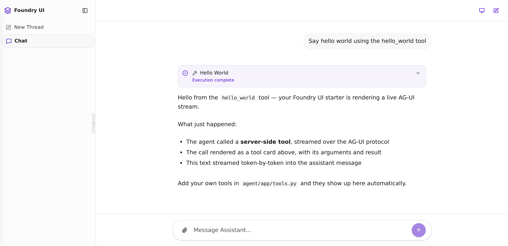

# Foundry UI

[](https://github.com/iLoveAgents/foundry-ui/actions/workflows/ci.yml)
[](https://www.npmjs.com/package/@iloveagents/foundry-web-ui)
[](LICENSE)

**The fastest way to a production-grade agent UI on the [AG-UI protocol](https://github.com/ag-ui-protocol/ag-ui), [Microsoft Agent Framework](https://github.com/microsoft/agent-framework), and [Microsoft Foundry](https://learn.microsoft.com/azure/foundry/).**

One command scaffolds a chat-first React app wired end-to-end to a streaming
FastAPI agent — tool calls rendered as live UI, MSAL auth ready, and a module
system that keeps your features composable instead of hardcoded.

Foundry UI is an [iloveagents.ai](https://iloveagents.ai) project, not a Microsoft product.

> **Status: alpha (0.x).** API surface is iterating. Pre-1.0 changes can break callers in minor bumps; expect lock-step updates.



<sub>The generated starter after one prompt — a server-side tool call streamed over AG-UI and rendered as a tool card, with the reply streaming in below. Captured from the real app by `pnpm screenshot:starter`.</sub>

## Why Foundry UI

- **AG-UI wiring hardened in production.** Foundry UI ships its own assistant-ui ↔ AG-UI layer: the `AGUIRunner` protocol engine plus an assistant-ui shim, with the stream-integrity handling long-running agents actually need — silent-close detection (a stream that dies mid-answer must not render as a clean, truncated completion), server heartbeats, a stalled-stream watchdog, and run errors surfaced in the message instead of an empty bubble. An official `@assistant-ui/react-ag-ui` provider now exists; at 0.0.x it drops AG-UI `CUSTOM`/`RAW` events and has no watchdog, so this stack keeps its own layer for now.
- **Chat as a control surface, not a widget.** Tool calls stream into real UI — tool cards, panels, context pins, client-side tools that modify shared app state.
- **Composable by design.** Features plug in as `ChatModule`s (pages, tool UIs, theme layers, providers, chat persistence) — the shell stays generic.
- **Auth included.** MSAL/Entra sign-in wired through the transport layer (`@iloveagents/foundry-agent/msal`), overridable for local dev or non-MSAL deployments.
- **Cross-runtime core.** The transport has zero React and zero DOM — reserved for future native / Outlook / Teams shells.
- **Agent-ready repo.** AGENTS.md everywhere, doc-grounding MCPs, and a Claude Code plugin for apps built on it (below).

## Quick Start

**Requirements:** Node.js 22+ and pnpm · [uv](https://docs.astral.sh/uv/) (runs the FastAPI agent service) · Azure CLI signed in with `az login` (the agent authenticates to Foundry via `DefaultAzureCredential`).

```bash
npm create lykomi-app my-app     # scaffolds + installs
cd my-app
cp agent/.env.example agent/.env     # set FOUNDRY_PROJECT_ENDPOINT + FOUNDRY_MODEL
az login
pnpm dev
```

You get a running chat app with quick starts, a FastAPI Agent Framework
service, and hello/weather tools to replace with your own. The generated app
ships its own `AGENTS.md` + README covering theming, adding tools, and MCP
servers.

## Packages

| Package                                                          | Tier          | Role                                                                                                                                             |
| ---------------------------------------------------------------- | ------------- | ------------------------------------------------------------------------------------------------------------------------------------------------ |
| [`@iloveagents/foundry-agent`](packages/agent)                   | Cross-runtime | Pure-TS AG-UI transport — `AGUIRunner`, vanilla zustand stores, MSAL subpath, service-fetch factory. Zero React, zero `@assistant-ui/*`.         |
| [`@iloveagents/foundry-web-primitives`](packages/web-primitives) | React-DOM     | Leaf UI primitives — Button, Checkbox, Input, Textarea, Field, FieldSet, `cn()`.                                                                 |
| [`@iloveagents/foundry-web-ui`](packages/web-ui)                 | React-DOM     | The actual agent UI — chat, composer, AG-UI adapter, message rendering, tool cards, panels, sidebar, context pins, theme runtime, and UI stores. |
| [`@iloveagents/foundry-web-shell`](packages/web-shell)           | React-DOM     | Browser bootstrap/layout — `bootstrapShell({ modules, pages, theme, authProvider })` mounts the SPA around `web-ui`. Module-agnostic.            |

Future tiers reserved by convention: `@iloveagents/foundry-native-{ui,shell,primitives}` (React Native), `@iloveagents/foundry-unity-*` (Unity), `@iloveagents/foundry-{outlook,teams}-shell`.

## Bootstrap An Existing React App

Use the shell package when you want Foundry UI as the app foundation but keep
your own routes, auth provider, and theme.

```bash
pnpm add @iloveagents/foundry-web-shell @iloveagents/foundry-web-ui @iloveagents/foundry-agent @iloveagents/foundry-web-primitives
```

```tsx
import "./index.css";
import { bootstrapShell } from "@iloveagents/foundry-web-shell";
import { ChatContent } from "@iloveagents/foundry-web-ui";

bootstrapShell({
  pages: [{ path: "/", element: <ChatContent /> }],
  theme: [{ id: "brand", definition: { branding: { appName: "Foundry UI" } } }],
});
```

Keep this import in your Tailwind entry CSS — plus `@source` directives so
Tailwind scans the built packages for the utility classes they use:

```css
@import "@iloveagents/foundry-web-ui/styles.css";
@source "../node_modules/@iloveagents/foundry-web-ui/dist";
@source "../node_modules/@iloveagents/foundry-web-shell/dist";
@source "../node_modules/@iloveagents/foundry-web-primitives/dist";
```

The default shell ships an MSAL auth provider that expects
`VITE_MSAL_CLIENT_ID` / `VITE_MSAL_AUTHORITY` / `VITE_MSAL_API_SCOPE` env vars —
without them the shell renders a config-error screen. For local, unauthenticated
dev pass your own `authProvider` (or an `agentFetch`) to `bootstrapShell`; see
the [`web-shell` README](packages/web-shell/README.md).

Features plug in as **ChatModules** — pages, tool UIs, theme layers, context
providers, and chat persistence contributed through one typed contract instead
of hardcoded wiring. See [`packages/web-shell/AGENTS.md`](packages/web-shell/AGENTS.md).

### Use As A Template Or Copy

Use a full copy when you want to own and deeply customize the UI, shell, and
agent service. Package-backed apps receive central fixes through dependency
updates; copied apps manually merge upstream improvements.

## How It Fits Together

```
Browser                                        Server
┌────────────────────────────────────┐         ┌──────────────────────────────┐
│ bootstrapShell()      (web-shell)  │         │ FastAPI + Agent Framework    │
│   └─ ChatModules: pages, toolUIs,  │  AG-UI  │   └─ add_agent_framework_    │
│      theme, providers, persistence │◄───────►│      fastapi_endpoint        │
│ Chat UI + tool cards  (web-ui)     │   SSE   │                              │
│ AGUIRunner transport  (agent)      │         │ Microsoft Foundry models     │
│ UI primitives   (web-primitives)   │         │ (DefaultAzureCredential)     │
└────────────────────────────────────┘         └──────────────────────────────┘
```

Details: import-direction graph, extension points, and the AG-UI runner
contract in [`AGENTS.md`](AGENTS.md) and each package's `AGENTS.md`.

## Develop

```bash
pnpm install
pnpm test           # build + lint + typecheck + unit tests
pnpm pack:check     # inspect real npm tarballs before publishing
pnpm smoke:starter  # scaffold, install, and build a generated starter
pnpm typecheck

pnpm screenshot:starter   # regenerate docs/assets/starter.png from the real app
```

Packages publish built ESM JavaScript and `.d.ts` declarations. CI also runs
`pnpm smoke:starter:browser`, which opens the generated starter in Playwright
Chromium, sends the hello-world quick start, streams a mocked AG-UI tool call,
and verifies the rendered chat response.

## Agent-Ready

The repo ships first-class support for AI coding agents:

- [`AGENTS.md`](AGENTS.md) (root + per-package, [open standard](https://agents.md/)) — read natively by Codex, Cursor, and Copilot coding agent; `CLAUDE.md` shims feed the same content to Claude Code.
- [`.mcp.json`](.mcp.json) — doc-grounding MCP servers (context7 + Microsoft Learn) for the fast-moving assistant-ui / AG-UI / Agent Framework stack.
- **Claude Code plugin** — apps _built on_ Foundry UI (including generated starters) can install the grounding + ChatModule-authoring skills:

  ```
  /plugin marketplace add iLoveAgents/foundry-ui
  /plugin install foundry-ui@foundry-ui
  ```

  Plugin source: [`plugins/foundry-ui/`](plugins/foundry-ui/).

## Contributing

See [`CONTRIBUTING.md`](CONTRIBUTING.md) — setup, test suite, and the
Changesets release flow. Security reports: [`SECURITY.md`](SECURITY.md).

## License

MIT — see [LICENSE](LICENSE).

### Optional 3D preview

[`@iloveagents/foundry-web-3d`](packages/web-3d/) adds a lazy GLB viewer,
an assembly tree and AG-UI part tools. It is a preview feature, released
independently, with no AR or backend indexing dependency.
