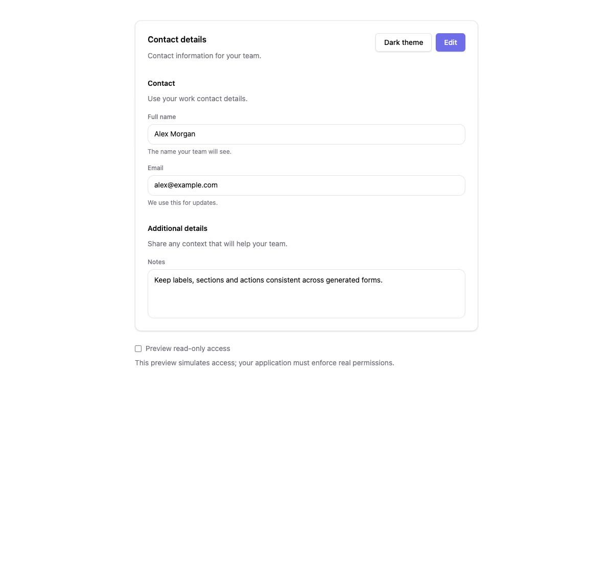
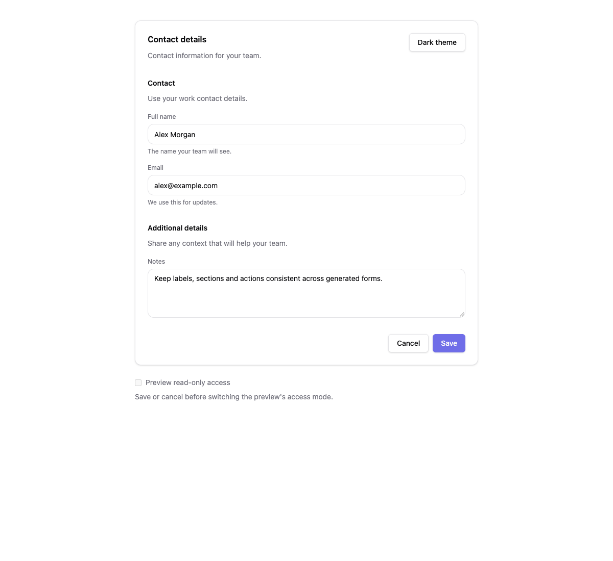

# Form preset verification

Checked locally on 6 October 2026 with the source example in `examples/form-ux`.
The example exercises explicit View/Edit, Save/Cancel and simulated read-only
access, with the same field slots and theme in each state.

Three field slots retained their x/y/width/height at 1200px in light mode and
390px in dark mode. The multiline editor displayed its full content. Keyboard
focus, required/help/error associations and zero/false display values have
component regression coverage. The browser also confirmed Edit focuses the first
control and Save/Cancel restore focus to Edit; Escape discards the demo draft and restores focus; both required controls show a
quiet requirement marker. Read-only access in the example is a simulation;
the consuming application must enforce actual permissions.

`pnpm test` passed: build, guidance drift, sensitive-term scan, format, typecheck
and 1,117 unit tests. `pnpm pack:check` passed for all eight packages.

This verifies the demonstrated flows, not every downstream application's
accessibility or usability. New exports require the Changesets/npm release
before downstream imports.
